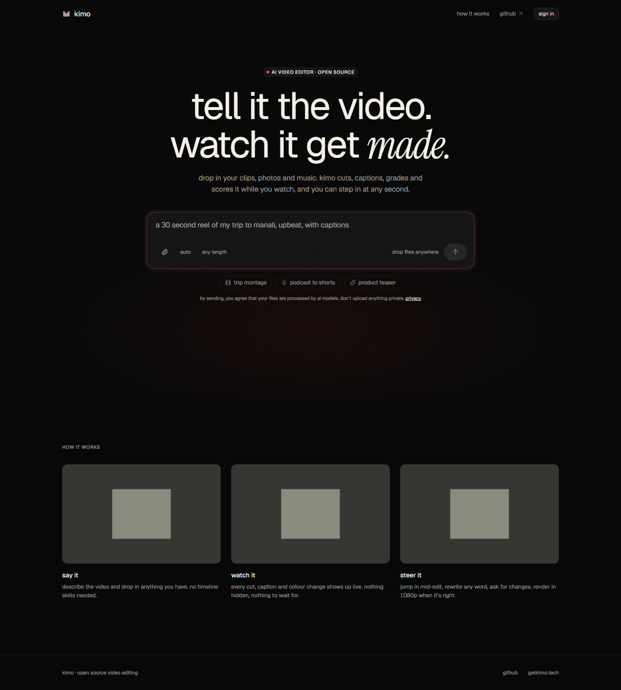
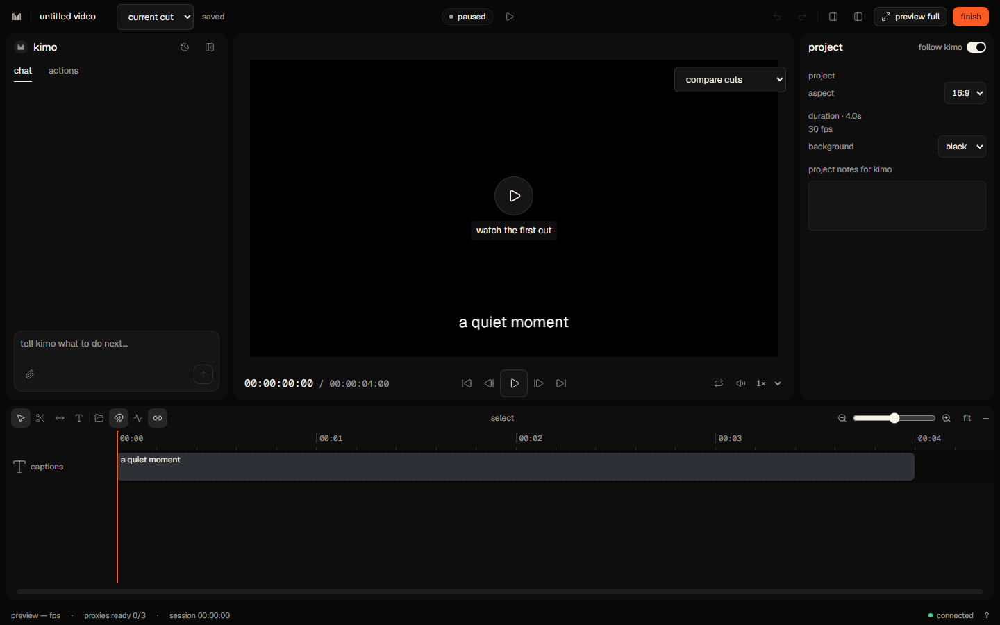
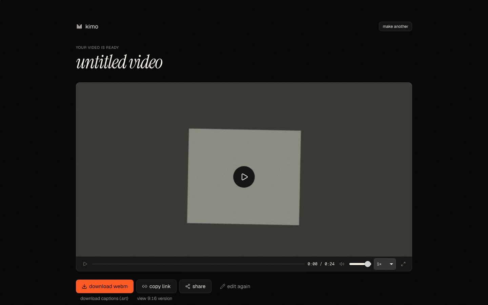

# kimo web

A browser video editor with a prompt-led landing page, uploads and warm-up, a live composited Studio, manual timeline/caption editing, an interruptible agent panel, review/export and delivery.

**Current mode: mock-backed frontend.** The real kimo backend is not built yet. Mock auth does not contact Google; edits and exports use scripted events and prerecorded CC0 media. Production endpoints in `.env.example` are placeholders. Nothing in Phase 10 deploys the app or tags v1.0.0.





## Run with the mock

Use Node 22 and pnpm 9.15.9.

```sh
pnpm install --frozen-lockfile
pnpm dev:mock
```

Open [kimo locally](http://localhost:3000). Web runs on 3000 and mock REST/WS on 8787. Alternatively run `pnpm dev` and `pnpm mock` in separate terminals. `pnpm mock:demo` prints the scripted event stream. Set `MOCK_SPEED=2` on the mock terminal to accelerate the demo. `MOCK_FAIL=upload|ws|action|render` exercises recovery.

A browser gets one anonymous video per UTC day in the mock. The sign-in dialog grants a demo identity via an httpOnly mock cookie. Clear site cookies to repeat the anonymous flow. Uploads live on the mock host's local disk; production retention is not implemented there.

## Configure a future backend

Create `apps/web/.env.local` with **actual verified** service URLs:

```dotenv
NEXT_PUBLIC_KIMO_API=<actual-rest-origin>
NEXT_PUBLIC_KIMO_WS=<actual-websocket-url>
```

The WS URL may be an origin using `/v1/sessions/:id/ws`, or `/v1/ws` with `sessionId` added as a query parameter. Public variables are embedded at build time. Never put model, OAuth or storage secret keys in them. Optional analytics/error variables are documented in `.env.example` and [deployment instructions](docs/DEPLOY.md).

```sh
# Set these to an isolated staging service before running:
# KIMO_CONTRACT_API=<actual-rest-origin>
# KIMO_CONTRACT_WS=<actual-websocket-url>
pnpm test:contract
```

Without the contract variables, that command starts and tests an isolated mock. It exercises writes, uploads and renders; use a test identity/data set on staging. See [backend handoff](docs/BACKEND_TODO.md) and [contracts](docs/CONTRACTS.md). The v1.0.0 tag waits for real-backend acceptance.

## Architecture

```text
Next.js / React UI
  | landing -> uploads -> warm-up -> Studio -> review -> render -> delivery
  |                               | Pixi live compositor + media pool
  |                               | timeline, inspector, captions, agent feed
  +-- typed REST / Zod client -----+-- IndexedDB outbox / ordered replay
  +-- reconnecting WebSocket ------+-- authoritative project versions
                 |
        local mock HTTP + WS today
        real auth / R2 / models / kimo engine later
```

| Workspace            | Responsibility                                                           |
| -------------------- | ------------------------------------------------------------------------ |
| apps/web             | Next 15 / React 19 UI, accessibility and browser media preparation       |
| packages/kimo-client | strict Zod contracts, typed REST, atomic ops and ordered synchronization |
| packages/compositor  | PixiJS live preview, media decoding, audio and capture                   |
| packages/mock-server | demo auth/quota, uploads, scripted agent and fixture delivery            |

Studio supports Ctrl/⌘P command search, named review cuts and restore, synchronized comparison, backend-supplied beat snapping, first-visit tips, 1080p/720p MP4/WebM requests, optional vertical delivery and SRT download. Offline manual operations are saved before display and replayed with stable mutation IDs. Real rendering and intelligent reframing remain backend work; [preview fidelity limits](packages/compositor/FIDELITY.md) are explicit.

## Verify and preview

```sh
pnpm lint
pnpm typecheck
pnpm test
pnpm build
pnpm budgets
pnpm exec playwright install chromium firefox webkit
pnpm e2e
pnpm shots
pnpm build:pages
```

`pnpm analyze` generates bundle treemaps. CI enforces initial gzip JS budgets, mobile loading/interaction budgets and a dedicated 20-minute memory gate. See [QA](docs/QA.md) for profiles, browser matrix, visual baselines, actual executed results and remaining manual checks. [Accessibility](docs/A11Y.md) does not claim unrun VoiceOver/NVDA or Safari certification.

The prepared hosting target is a new **Cloudflare Pages `kimo-app`** project at **app.getkimo.tech**. The Pages build exports static route shells and a small public metadata Function; local Next SSR remains available. PR artifacts use the mock. No deployment command or DNS change is performed. Follow [DEPLOY.md](docs/DEPLOY.md) when publishing is authorized, and coordinate with the separate Workers workflow branch before choosing one hosting path. Marketing remains a separate repository; its handoff is [MARKETING_LINK.md](docs/MARKETING_LINK.md).

Read [DESIGN.md](docs/DESIGN.md), [DECISIONS.md](docs/DECISIONS.md), [STATES.md](docs/STATES.md), [PHASE_LOG.md](docs/PHASE_LOG.md) and the [three-minute demo script](docs/DEMO_SCRIPT.md). The supplied logo and fixed visual tokens remain authoritative. Media licenses/checksums are in [fixture sources](packages/mock-server/fixtures/SOURCES.md); OFL font licenses remain under apps/web/src/assets/fonts.
