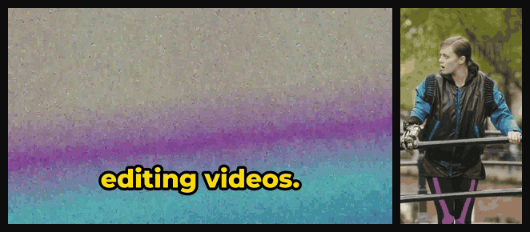
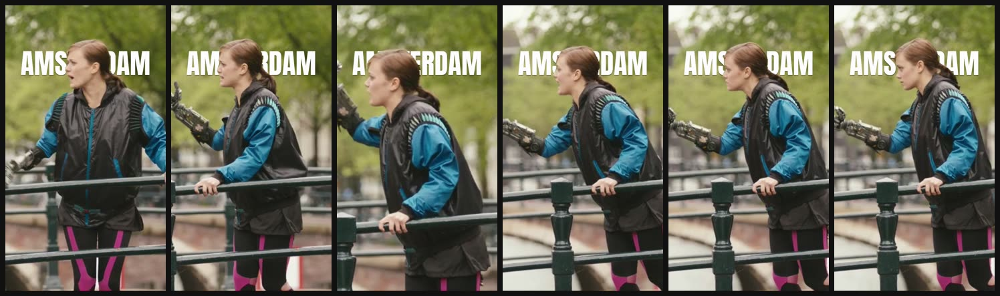
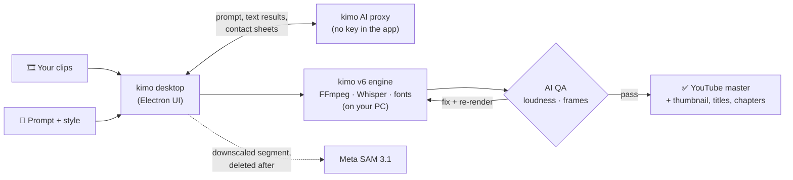

<div align="center">

<picture>
  <source media="(prefers-color-scheme: dark)" srcset="docs/readme/kimo-mark-on-dark.svg">
  <source media="(prefers-color-scheme: light)" srcset="docs/readme/kimo-mark-on-light.svg">
  
</picture>

# kimo

**Tell it the video you want. Watch every edit happen.**

An AI video editor for Windows that runs the real kimo v6 engine on your PC,
with FFmpeg, local Whisper and fonts bundled in one installer.

[](https://github.com/naman-sharma12345/kimoapp/releases/latest)
[](https://github.com/naman-sharma12345/kimoapp/releases)
[](https://github.com/naman-sharma12345/kimoapp/releases/latest)
[](desktop)

<br>

<a href="https://github.com/naman-sharma12345/kimoapp/releases/latest">
  
</a>

<sub><a href="https://getkimo.tech">getkimo.tech</a> · <a href="https://github.com/naman-sharma12345/kimoapp/releases">all releases</a> · <a href="desktop/README.md">desktop docs</a></sub>

<br><br>



<sub>Left: a kimo 16:9 edit with word-by-word captions. Right: SAM 3.1 tracks the subject on a 9:16 reframe and the title sits behind her.</sub>

</div>

---

## ✨ Features

<table>
  <tr>
    <td width="33%" valign="top"><h3>🎬 Live AI edits</h3>kimo writes the edit script and drives its tools (rough cut, captions, titles, grade, punch-ins, reframe, audio finish). Every AI step and tool call streams with timers, and the preview updates after each change.</td>
    <td width="33%" valign="top"><h3>🎨 Style presets</h3>Energetic, Documentary, Podcast clip, Cinematic, Tutorial or Auto. One prompt, a consistent look.</td>
    <td width="33%" valign="top"><h3>📺 YouTube master</h3>H.264 High, closed GOP, AAC 384 kbps, <b>-14 LUFS</b> / ≤ -1 dBTP. 16:9 (1080p or 4K), 9:16, 1:1 and 4:5.</td>
  </tr>
  <tr>
    <td valign="top"><h3>🔍 AI QA</h3>Each pass is measured (loudness, true peak, black frames, dead air) and AI-checked on 18 frames. Faults are fixed and re-rendered, up to 3 passes.</td>
    <td valign="top"><h3>✂️ Edit it yourself</h3>Drag timeline to move, trim, delete and fix caption text, or ask for changes in chat. Both apply on top of the saved project, with before/after.</td>
    <td valign="top"><h3>🖼️ YouTube pack</h3>Thumbnail, title, description and chapters, generated alongside the edit.</td>
  </tr>
  <tr>
    <td valign="top"><h3>💬 Captions-only mode</h3>Fully offline: Whisper runs on your PC, no internet needed.</td>
    <td valign="top"><h3>📦 Batch & library</h3>Drop files or whole folders. Every edit is saved locally with its history, edit script and op log. One prompt can edit a whole queue.</td>
    <td valign="top"><h3>⚡ GPU small copy</h3>Small copies re-encode on NVENC, Quick Sync or AMF when your PC has one.</td>
  </tr>
</table>

### 🧠 New on `main`: Meta SAM 3.1 subject effects



| Effect | What it does |
| --- | --- |
| 🎯 **Subject reframe** | 9:16, 1:1 and 4:5 exports follow the subject with a smoothed virtual camera instead of a centre crop |
| 🔎 **Punch-ins** | Zooms centred on the subject, automatic or placed by the AI editor |
| 🅰️ **Text behind subject** | Big titles sit between the background and the person |
| 🌫️ **Background** | Blur, solid colour or your own image, subject kept sharp; or a transparent ProRes 4444 cutout |
| 🙈 **Blur by prompt** | Blur every "face", "license plate", "logo" or anything you name |

Type any subject ("dog", "red car"), preview the masks, then run the effect alone or as part of a full AI edit. These ship in the next release (0.3.0); see [release notes](desktop/RELEASE_NOTES.md).

## ⚙️ How it works



## 🚀 Quick start

1. Download **`kimo-Setup-0.3.2.exe`** from the [latest release](https://github.com/naman-sharma12345/kimoapp/releases/latest).
2. The installer isn't code-signed yet, so SmartScreen may say *"Windows protected your PC"*. Click **More info → Run anyway**.
3. Drag in a video, pick a style, describe the edit and hit go. kimo updates itself from GitHub Releases and asks before restarting.

No Docker, no separate engine, no size or length caps: long videos and 4K are fine.

## 🔒 Privacy

- **Your media stays on your PC.** Rendering, FFmpeg and Whisper transcription all run locally.
- **AI goes through kimo's proxy.** AI edits send only the prompt, text results from the engine, and per check two contact sheets, two frames and measured audio numbers. No API key ships in the app.
- **SAM is scoped and temporary.** Subject effects upload a downscaled (≤720p, silent) copy of only the segment being processed, which is deleted afterwards.
- **Captions-only works offline.**

## 🗺️ Roadmap

- [ ] 🍎 macOS build
- [ ] 🔏 Code signing (goodbye, SmartScreen prompt)
- [ ] 🖥️ GPU rendering for full exports
- [x] 🧠 SAM 3.1 subject effects (on `main`, next release)

## 🛠️ Build from source

The desktop app lives in [`desktop/`](desktop). It needs the bundled tools (kimo-mcp, FFmpeg/FFprobe, whisper.cpp + `ggml-small-q5_1` model) in `desktop/vendor`; the [desktop workflow](.github/workflows/desktop.yml) shows exactly how they're fetched.

```sh
cd desktop
npm ci
npm start        # run the app
npm run dist     # build the NSIS installer (Windows)
```

CI (`windows-latest`) builds the installer, installs it on the runner, runs `kimo.exe --smoke <clip>` (engine start, FFmpeg, Whisper captions, one real render) and publishes the release.

<details>
<summary><b>Repo layout</b></summary>

| Path | What's there |
| --- | --- |
| `desktop/` | Windows app (Electron), engine + SAM bridge, installer config |
| `apps/web` | Next.js / React browser studio |
| `apps/api` | Cloudflare Worker API: AI proxy, SAM, editing sessions |
| `packages/` | typed client, PixiJS compositor, mock server |
| `deploy/` | hosting config and the [self-hosted engine setup](deploy/kimo-engine/README.md) |
| `docs/` | design, contracts, QA and decision records |

Web dev: Node 22 + pnpm 9.15.9, then `pnpm install --frozen-lockfile && pnpm dev:mock` (web on :3000, mock API on :8787). Checks: `pnpm lint`, `pnpm typecheck`, `pnpm test`, `pnpm e2e`.

</details>

## 🙏 Credits & notices

- Demo footage (9:16 clip): *Tears of Steel* © Blender Foundation | [mango.blender.org](https://mango.blender.org), licensed [CC BY 3.0](https://creativecommons.org/licenses/by/3.0/).
- Subject effects use Meta **SAM 3.1** (Segment Anything). Bundled FFmpeg, whisper.cpp and font licenses are in [THIRD_PARTY_NOTICES.md](desktop/THIRD_PARTY_NOTICES.md).

<div align="center">
<br>
<sub>Made by <a href="https://github.com/naman-sharma12345">Naman Sharma</a> · <a href="https://getkimo.tech">getkimo.tech</a></sub>
</div>
