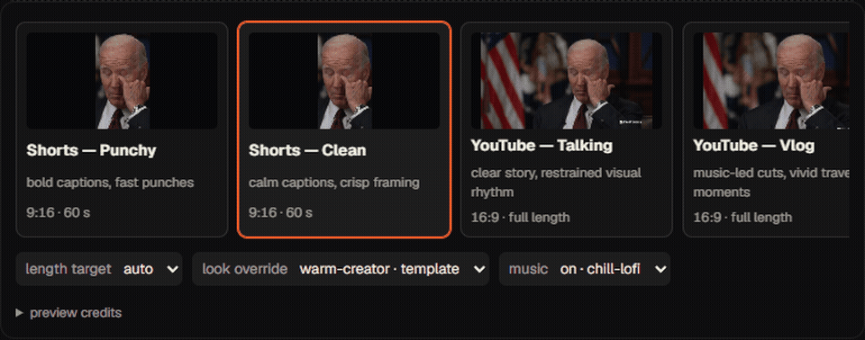
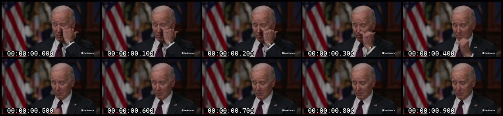
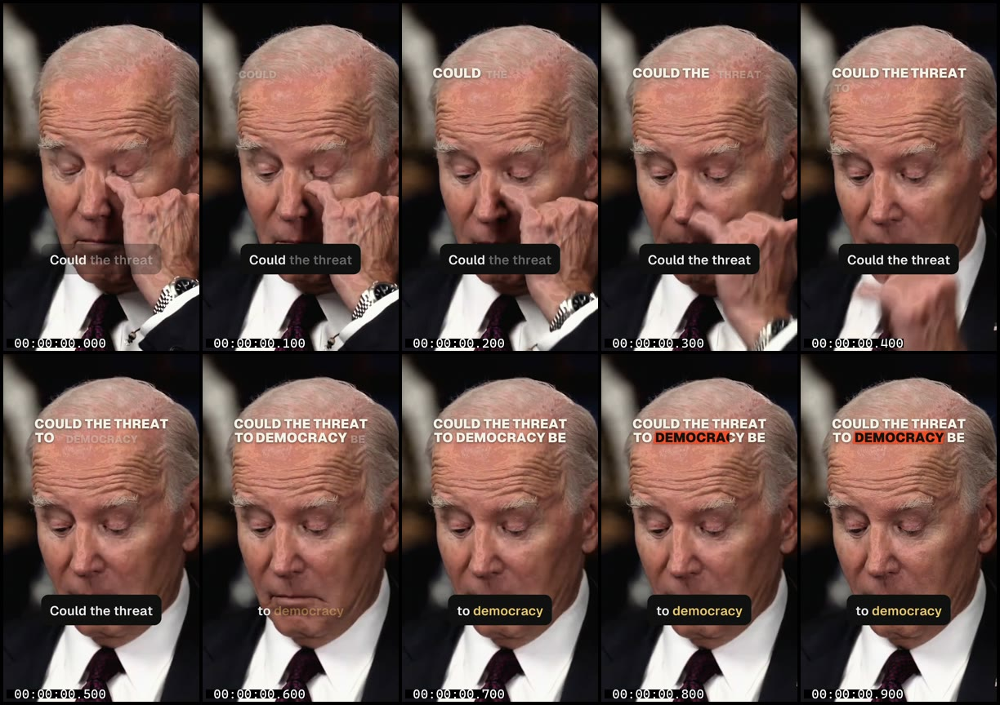

<div align="center">

<picture>
  <source media="(prefers-color-scheme: dark)" srcset="docs/readme/kimo-mark-on-dark.svg">
  <source media="(prefers-color-scheme: light)" srcset="docs/readme/kimo-mark-on-light.svg">
  
</picture>

# kimo

**Tell it the video you want. Watch every edit happen.**

A Windows AI video editor powered by Meta Muse Spark 1.3 and SAM 3.1, with local
Whisper transcription and FFmpeg rendering.

**[▶ Watch the three-minute demo](https://drive.google.com/file/d/1EhnILN-B9R2-70W1ZdotUbUS065aiO01/view?usp=drivesdk)**

[Download for Windows · latest release](https://github.com/naman-sharma12345/kimoapp/releases/latest)
· [All releases](https://github.com/naman-sharma12345/kimoapp/releases)
· [Desktop guide](desktop/README.md)
· [Docs index](docs/README.md)

</div>

## Built with Meta

- **Muse Spark 1.3** plans the edit from the prompt, transcript and footage context,
  then critiques rendered frames and measurements to propose structured corrections.
  The default Meta route uses `muse-spark-1.3-contributor`.
  [Planner](desktop/planner.mjs) · [Critic](desktop/critic.mjs) · [Meta API route](apps/api/src/ai.ts).
- **SAM 3.1** segments and tracks subjects for effects such as follow-subject
  reframing, text behind a subject, background blur, cutouts and object blur.
  It runs when a subject effect is requested.
  [Desktop tracking/effects](desktop/sam.mjs) · [SAM API route](apps/api/src/sam.ts).

Both models are accessed through Meta Model API via kimo's proxy. Transcription
and video rendering run locally; see the data-sharing details below.

## Built during the hackathon

The kimo app and creator pipeline were built from **October 26 to November 4, 2026**
for this hackathon: the Studio, planner/critic loop, compositor, subject-effects
integration and installer. The earlier open-source [kimo v6 engine](https://github.com/naman-sharma12345/kimo)
was reused as a dependency and is not claimed as new hackathon work. The v0.5.0
release updates that bundled dependency to v8.12.1.

## Faster exports in v0.5.0

- One decode pass for footage analysis instead of two.
- Independent clip segments, and long exports' 30 s render stages, render in parallel.
- A `framePlan()` rounding fix keeps ordinary clips on the fast direct path (and removes a repeated-frame stutter).
- Lossless intermediates switched from ffv1 to ffvhuff, frame-for-frame identical.
- Hardware decode on by default with software fallback; all CPU cores used for export.
- Measured on a 4-core machine with no GPU: about **2.7x faster** on a 127 s timeline, and a further **~22%** on a real 700 s 720p export. Long exports now delete each stage's scratch files once verified.
  [Release notes](desktop/RELEASE_NOTES.md) · [Performance](desktop/PERFORMANCE.md)

## Creator edits

Nine templates cover clean/punchy shorts, talking-head YouTube videos, vlogs,
tutorials, podcast clips, documentaries, music montages and explainers. They
combine transcript cuts, a camera director, animated captions, graphics/b-roll,
speech-synced visuals, sound design and colour finishing with a structured planner
and critic. Templates provide starting policies; quality depends on the footage
and plan. [Template details](desktop/README.md#templates).



The picker demonstration uses ProPublica's _Unedited: ProPublica Interviews
President Biden, September 2023_, [source](https://commons.wikimedia.org/wiki/File:Unedited-_ProPublica_Interviews_President_Biden,_September_2023.webm),
[CC BY 3.0](https://creativecommons.org/licenses/by/3.0/). The preview is cropped,
styled and captioned; labels are not dialogue or endorsement.

| Before: prepared raw interview                      | After: clean-shorts fixture                            |
| --------------------------------------------------- | ------------------------------------------------------ |
|  |  |

Both are actual benchmark first-second sheets from the same ProPublica source
credited above. The after image uses an offline deterministic plan; its hand-over-
face opening and competing hook/caption text are documented limitations.
This shows the transformation, not a claim of professional editorial quality.

Editing uses a reduced preview; export renders the full saved timeline with
software x264 medium. The optional small copy can use NVENC, Quick Sync or AMF.
Pass caches retain base picture, overlays and audio stems. Conservative background
worker limits reduce contention while you use the computer; full export still
uses CPU and disk.

Studio exposes live stages, seven timeline lanes, camera and caption controls,
sound/look inspectors, source-anchored edits and undo/redo. Quality checks retry a
failing critical stage once and show remaining failures or unavailable evidence.
Creator Score is an explicitly limited heuristic, not a human editorial grade.

Read the [final benchmark report](desktop/test/bench/FINAL.md) and
[measured results](desktop/test/bench/RESULTS.md) for real before/after evidence,
performance, source credits and unresolved limits. Hosted replay checks do not
prove provider adherence or interactive updater behaviour.

## Install and privacy

Download the [latest Windows release](https://github.com/naman-sharma12345/kimoapp/releases/latest)
and choose the **small online setup**. v0.5.0's launcher is **225 KB**; a fresh
installation pulls the full app once from Cloudflare's CDN, with GitHub as backup.
Updates reuse the cached prior installer: the verified v0.4.3 → v0.5.0 upgrade
downloads **74.09 MB** and reuses **295.60 MB**, preserving the saved project.
Re-running setup on v0.5.0 skips download and reinstall. If an incremental update
cannot be prepared, setup asks before a full download; silent setup stops.
The complete offline installer is also available in the release.
[Installer qualification and provenance](desktop/distribution/ONLINE-0.5.0.md).
The package is unsigned, so Windows may display SmartScreen. The app checks GitHub
for updates and asks before restarting. Inputs over three hours are refused;
large/4K footage is subject to available disk and memory.

Rendering and Whisper run locally. AI edits send prompts, text tool results and
selected review images/audio measurements through the existing proxy. SAM effects
send a downscaled silent segment for tracking, deleted afterwards. Captions-only
works offline. No provider key is bundled. See [privacy and notices](desktop/README.md#privacy).

## Build and check

```sh
npm ci --prefix desktop
npm test --prefix desktop
npm run build:renderer --prefix desktop
```

The bundled tools belong in `desktop/vendor`. The manual
[Windows workflow](.github/workflows/desktop.yml) bootstraps tools, tests, builds
and installs the package, then runs offline creator replays. `release=true`
publishes only after qualification. The separate full-bench workflow checks all
nine templates against a committed score baseline with a three-point tolerance.
Full footage renders and installer builds run on hosted runners.

| Path        | Contents                                                            |
| ----------- | ------------------------------------------------------------------- |
| `desktop/`  | Windows app, creator pipeline, compositor, SAM bridge and installer |
| `apps/web/` | Browser Studio                                                      |
| `apps/api/` | Existing proxy and editing-session backend                          |
| `packages/` | Typed client, compositor and mock server                            |
| `deploy/`   | Hosting and self-hosted engine setup                                |
| `docs/`     | Design, contracts, decisions and QA evidence                        |

Web development uses Node 22+ and pnpm 9.15.9:
`pnpm install --frozen-lockfile && pnpm dev:mock`. The web runs on port 3000 and
the mock API on 8787. Required checks: `pnpm lint`, `pnpm typecheck`, `pnpm test`,
`pnpm build`; browser checks: `pnpm e2e`.

[Third-party notices](desktop/THIRD_PARTY_NOTICES.md) cover bundled assets and
tools. Benchmark outputs carry their own source-specific credits. macOS, code
signing, multicam synchronization and interactive old-install upgrade validation
remain separate work.

## License

Original kimo app source is available under the [MIT License](LICENSE).
Bundled dependencies, model access, fonts, media and separately licensed assets
retain their own licenses and terms; see the [third-party notices](desktop/THIRD_PARTY_NOTICES.md).
