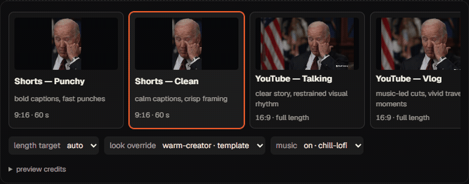
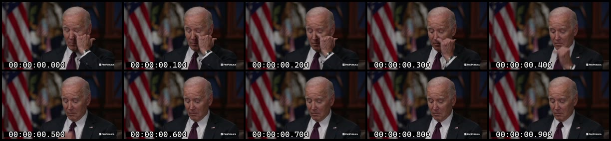
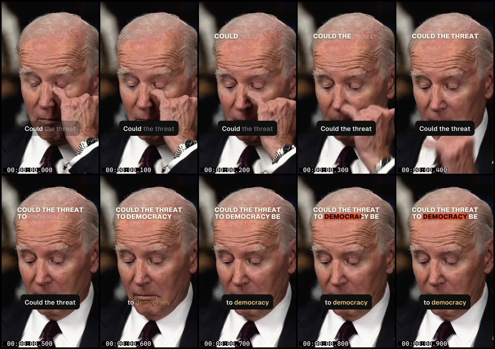

# kimo for Windows

Creator editing with local Whisper, a frame-exact compositor, FFmpeg and fonts in
one Windows installer. Creator picture rendering uses the frame-exact compositor.

## Install and edit

Download the [small online setup from the latest release](https://github.com/naman-sharma12345/kimoapp/releases/latest).
Setup downloads changed installer blocks and reuses the cached previous
installer for updates. It includes the earlier bounded-render and Windows path fixes.
Update the app and resume the saved edit; no reimport or project deletion is needed.
First installation downloads and verifies the 369 MB app through Cloudflare's CDN,
with GitHub as backup. Updates reconstruct the same verified installer locally;
they need the previous installer in the updater cache and sufficient free disk
space. If a small update is unavailable, setup and background updates ask before
a full download. Silent setup fails instead. The complete offline installer remains in
[GitHub Releases](https://github.com/naman-sharma12345/kimoapp/releases/latest).
The installer is unsigned; Windows may show its SmartScreen confirmation. Updates
come from GitHub Releases and ask before restarting.

The CDN uses the existing free Cloudflare account without R2 or a payment card.
The small setup stays below 2 MB and the app payload is about 369 MB. Hosted
download/upgrade checks preserve saved project data; connection speed and
disk/antivirus conditions affect actual installation time.
See [distribution verification](distribution/QUALIFICATION.md) for exact hashes,
failure checks and hosting details.
The [v0.5.0 setup record](distribution/ONLINE-0.5.0.md) explains the published
payload, incremental transfer sizes and installer qualification.
The [v0.4.3 patch record](distribution/PATCH-0.4.3.md) records the original incremental update checks.
The [v0.4.2 patch record](distribution/PATCH-0.4.2.md) includes the bounded-render,
frame-ID, local CPU and installed-app regression checks.

Drop files or a folder, choose a template, and describe the edit. AI planning needs
the existing AI access configuration; captions-only transcription works offline.
Each project keeps its plan, EDL, history and operation log locally. Inputs longer
than three hours are refused with a trimming message. Large/4K sources work within
available disk and memory; no real-time or maximum-size guarantee is made.

## Templates



| Template | Starting direction |
|---|---|
| Shorts — Clean | Restrained portrait captions and concise speech cuts |
| Shorts — Punchy | Faster portrait cuts, punch-ins and accented captions |
| YouTube — Talking | Landscape speech, varied framing and supporting visuals |
| YouTube — Vlog | Speech and context shots arranged into a story |
| Tutorial | Readable demonstrations, labels and measured pacing |
| Podcast clips | Portrait extracts from conversation |
| Documentary | Landscape narrative, lower thirds and supporting images |
| Music montage | Visual rhythm and music rather than speech-first cuts |
| Explainer | Speech-synced cards, callouts and supporting visuals |

Length, aspect, captions, look and music can be overridden. A template is a
starting policy, not a promise to imitate a particular creator. The small card
previews demonstrate framing/caption styles, not complete generated edits.
Preview footage: ProPublica, *Unedited: ProPublica Interviews President Biden,
September 2023*, [source](https://commons.wikimedia.org/wiki/File:Unedited-_ProPublica_Interviews_President_Biden,_September_2023.webm),
[CC BY 3.0](https://creativecommons.org/licenses/by/3.0/); cropped, styled and
captioned as a demonstration. Labels are not dialogue or endorsement.

| Before: prepared raw interview | After: clean-shorts fixture |
| --- | --- |
|  |  |

Actual benchmark first-second sheets, using the ProPublica source credited above.
The after image is a deterministic offline fixture. Its weak opening and
competing hook/caption text are retained as honest evidence, not a quality claim.

## Preview, export and quality

Editing renders a reduced preview: 540 pixels on the short side, with x264
ultrafast. Export renders the saved full-resolution EDL with software x264 medium,
then produces H.264/AAC delivery. A compatible GPU is used only for the optional
small upload copy. Decode defaults to CPU; `KIMO_HW_DECODE=auto` opts into
hardware decode with CPU fallback on a supported driver. Startup and engine-status
refreshes do not probe GPU encoders. This avoids unnecessary driver activity.
One background job runs at a time with a conservative default worker budget.
These limits reduce contention; rendering still consumes CPU and disk.

Base picture, caption/graphic overlays, dry audio stems and mastered passes have
separate content keys. Gain-only changes copy the encoded picture. Captions reuse
the base; structural camera/story changes rebuild it. Studio has timeline edits,
source-anchored overrides, undo/redo, live stages and a Quality tab. See
[Studio controls](studio-README.md).

Critical checks cover repeats, camera jitter, encoded true peak, caption safe
area, dead air and first speech. A failing stage gets at most one automatic local
retry. Remaining failures are shown in Studio; unavailable measurements stay
unverified and cannot produce an all-green result. Creator Score is a heuristic,
not a human editorial rating. Natural footage can be too ambiguous for unique
frame matching; synthetic barcode tests independently check frame selection.

Input preparation converts detected VFR to a standard CFR, bakes rotation and
tone-maps PQ/HLG to SDR BT.709 using Hable. Checkpoints retain completed stages;
an interrupted creator edit can resume without renewing its AI call allowance.
Stop cancels the worker process tree. Settings shows the cache size and can clear
rebuildable cache while keeping projects and input copies.

## Evidence and limitations

[Final qualification](test/bench/FINAL.md), [measurements](test/bench/RESULTS.md)
and [baseline provenance](test/bench/release-baseline.json) describe the actual
hosted results, known limits and source credits. Before/after comparisons are
benchmark evidence, not a promise that every AI plan improves the source.
Provider adherence, human taste and interactive updater behaviour are distinct
from offline replay tests. See [updater verification](test/UPDATER.md).

## Privacy

Rendering and transcription run locally. AI editing sends prompts, text tool
results and selected review images/audio numbers through the existing kimo proxy.
SAM effects send a downscaled silent segment for tracking; the proxy deletes that
upload afterwards. This is not a wholly offline AI service. No provider key is
bundled. [Third-party notices](THIRD_PARTY_NOTICES.md) list asset/tool licences.

## Build and qualification

```sh
npm ci --prefix desktop
npm test --prefix desktop
npm run build:renderer --prefix desktop
```

Bundled tools must be in `desktop/vendor`; the workflow bootstraps them. The
manual [Windows workflow](../.github/workflows/desktop.yml) builds and installs
the NSIS package, runs renderer/schema/robustness tests and two installed creator
replays, and uploads video, metrics and HTML reviews. Only `release=true` publishes
after those steps pass. `creator-full-bench.yml` separately runs all nine template
cases or the four-core performance budget. Replays have no paid fallback and
never renew the historical spending ledger. Full media work belongs on hosted
runners, not a foreground development PC.
