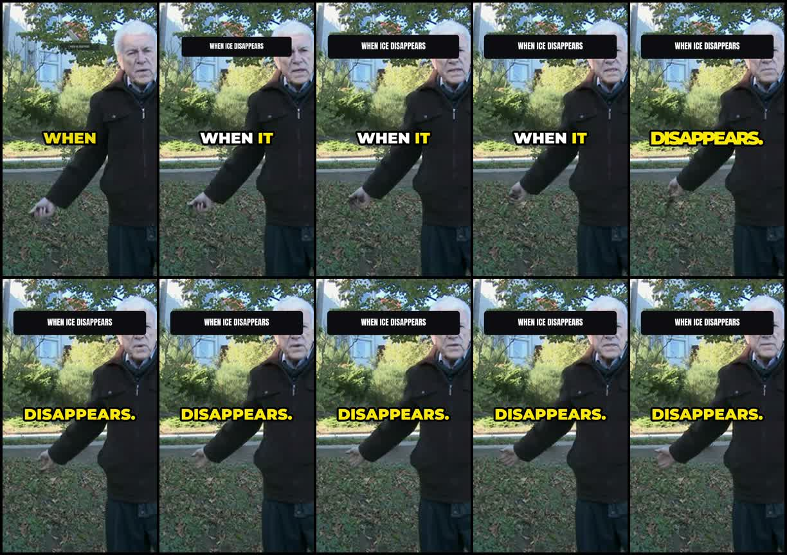
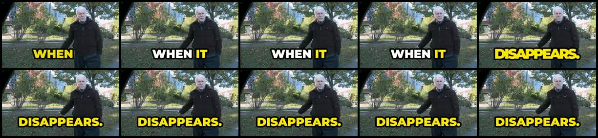

# Visual baseline review

30 October 2026 update: **The user requires a new raw dataset for final benchmark acceptance and has no footage to supply.** Existing public clips and all their before/after outputs remain legacy evidence. Phase 1 cloud run `40891223587` saved failed TH-1 and TH-2 recordings before timing out during TUT-1. Both artifacts are preserved locally, with exact prepared media and genuine response caches. This does not complete the requested six-clip AI baseline. Phase 2's six old offline compositor controls completed in `41027923346`; they cannot satisfy the new dataset requirement. Inspect actual contact sheets and hook frames before adding critiques here.

## Preserved TH-1 AI output: both aspects

Inspected the actual one-second contact sheets and ten first-second frames from the saved final videos. Small evidence and original hashes: [portrait](baselines/cloud-before-TH-1/9x16/provenance.json), [landscape](baselines/cloud-before-TH-1/16x9/provenance.json). Source licence/attribution remains in [CREDITS.md](CREDITS.md). These are failed Phase 1 record outputs, not successful replay evidence or completed Phase 2 renders.

1. The portrait first second places the speaker against the right edge; the crop gives his gesture room while sacrificing comfortable head room.
2. The hook box appears by the 0.1-second sample and crosses his forehead/eyes. Fast appearance alone does not make this a good hook treatment.
3. The landscape opening keeps the full figure readable and uses a calmer composition than the portrait crop.
4. Large yellow/white word captions have strong contrast, but their changing colour and scale compete with the documentary footage.
5. Portrait captions sit around the torso/middle rather than a consistent lower safe area; the opening title makes that frame especially crowded.
6. The original green identification bar is cut off in the portrait crop around seconds 2–8. Reframing needs to account for existing on-source graphics.
7. The wide version also places new captions over the original identification bar, so this is not solely an aspect-ratio issue.
8. The cut to the bookcase interview around 12 seconds creates a clear scene change; it is stronger than adding another small punch to the outdoor shot.
9. Long bookcase spans still feel visually repetitive in the sampled sheet. The saved maximum static span is 9.31 seconds against the six-second target.
10. The book-cover insertion is relevant to the subject, but the licensed source is already edited; its presence is not proof that the planner found fresh b-roll.
11. The portrait sheet shows a ghosted cover/interview transition around 30 seconds. Single sampled images cannot establish whether its motion is smooth.
12. Portrait output has a black frame with surviving caption text near 37 seconds. Picture and caption bounds need to share an intentional end.
13. Empty cells below the landscape sheet's final row are sheet padding, not evidence that the 54.22-second video ends with that much black.
14. Historical matching reports 21/27 repeated frames with only 50.5%/37.9% coverage (portrait/wide); animated mappings were skipped. Uniform remeasurement is required before comparing current counts.
15. The wide caption near 40 seconds visibly includes “IT'S UM…”, while the old filler estimate is zero. That conflict needs audio review; it is not evidence of perfect filler removal.
16. Recorded loudness is -14/-14.2 LUFS and true peak -1.5/-1.4 dBTP. Those numbers do not establish listening quality, click removal or sound-design quality.

The six requested golden baselines are **pending**. The live TH-1 AI run and its replay were stopped to restore PC responsiveness. TH-2, TUT-1, VLOG-1, POD-1 and MUSIC-1 outputs were not rendered or visually reviewed; neither was the 16:9 set. Source-media substitutions are described in clips/clips.json and CREDITS.md. These are not checked acceptance boxes.

## Supplemental five-second smoke critique

This completed captions-only render predates resource/GPU changes. It is a technical/visual smoke check, not a creator benchmark replacement.

1. Whisper places speech onset at zero; this measures timing rather than the strength of the opening.
2. The opening portrait crop cuts off both speakers before the woman moves farther into frame.
3. There is no independently authored hook title; the early text is dialogue captioning.
4. Large uppercase captions are legible against the footage.
5. Captions sit in the lower third. The conservative text envelopes cross the reserved right-side Shorts region.
6. The widest visible lines extend into that right-side region; exact raster bounds still require a more precise detector.
7. Keyword yellow is present, but this is the existing engine style rather than the future creator caption system.
8. Caption placement is repetitive rather than editorially composed shot by shot.
9. The single wide framing has no deliberate medium/tight alternation.
10. There is no b-roll, lower third, callout or intentional sound-design event in this smoke.
11. Dialogue loudness is close to the upload target and true peak stays below -1 dBTP.
12. LRA is only 1.2 LU; this short dialogue sample cannot establish long-form sound quality.
13. The output extends 0.333 seconds beyond the five-second source; the sheet shows the dark tail.
14. That tail contributes clipped luma and a failed delivery gate.
15. Matched source pairs show zero repeats, but 93.7% coverage is insufficient to certify the entire output.
16. A 74.1 score must not be treated as approval: safe-area, framing and delivery failures remain.

Opening the local review confirmed video playback, timeline seeking, offline operation and the corrected mobile layout. Review media lives in out/scratch/bench-smoke; the small contact sheet and metrics are committed under baselines/smoke-v0.3.2.

No real-footage before/after critique of the resource controls or NVENC master is claimed. Full golden recordings now run remotely; they do not establish local sustained responsiveness or GPU perceptual-quality sign-off.

## Saved-AI TH-1 landscape recompose review (legacy diagnostic)

Actual contact sheets and ten first-second samples were inspected for both outputs from41089587650. [Before sheet](baselines/composed-real-AI-TH-1/before/sheet.jpg), [after sheet](baselines/composed-real-AI-TH-1/after/sheet.jpg), [before first second](baselines/composed-real-AI-TH-1/before/hook.jpg), [after first second](baselines/composed-real-AI-TH-1/after/hook.jpg). Source attribution remains in CREDITS.md.

1. The after output restores the native project's black hook-background rectangle.
2. It appears across the speaker's chest in the early sampled frames.
3. Hook lettering on that bar is very small and has poor practical legibility.
4. Restoring geometry does not fix the planner's hook typography.
5. Large body captions remain the most prominent new graphic treatment.
6. They still overlap the source's green identification bar.
7. Existing source edits include an outdoor interview, bookcase footage and book-cover imagery.
8. Their presence cannot be credited as newly chosen app b-roll.
9. The source's cover transition remains visible in both sheets.
10. The later interview spans still have little framing variation.
11. A visible caption contains filler wording despite the automatic zero-filler estimate.
12. The after delivery gate passes and measured clipped luma falls.
13. Frame matching has only about69–71%coverage; counted repeats are not full-footage certification.
14. Whole-picture motion values include source/overlay changes and do not isolate camera jitter.
15. Uniform version1 score79.7→80.3 is a diagnostic observation, not certified causal improvement.
16. The preserved failed recording leaves before-video/project-state pairing uncertain; the new raw comparison must export both sides from the same saved state.

No full listening review is inferred from these stills. These outputs remain legacy evidence and do not close the user's new-raw-dataset acceptance.
