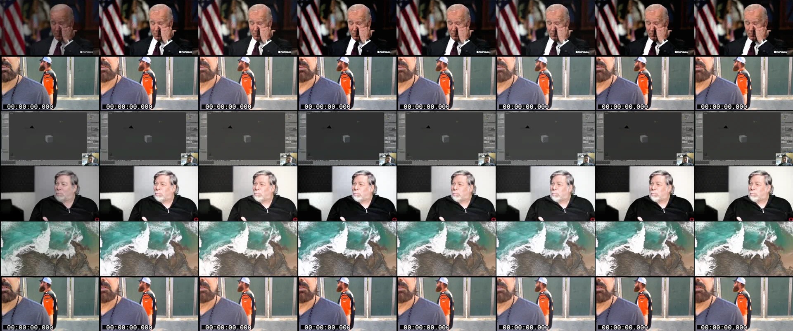

# Phase 9 still review — 1 November 2026

This is a lightweight still review, respecting the user's standing instruction
against lengthy testing/benchmarks and full local renders. No paid calls or full
golden videos were processed. This does not close real-footage benchmark gates.

Rows: TH-1, TH-2, TUT-1, POD-1, MUSIC-1, VLOG-1. Columns: source, clean,
warm-creator, mkbhd-crisp, cinematic-teal-orange, vlog-bright, moody-doc, kimo.
Each row uses one already-created first-second contact-sheet tile. Those tiles
contain compression, occasional timestamps and small watermarks; they cannot
stand in for original RGB camera frames or a full temporal review.

## Actual visual inspection

- **TH-1:** the original face is dim. Correction makes it easier to read while
  retaining the dark room. The first attempt pushed the forehead too high;
  the final skin highlight guard restrains that rise. Hair and white flags remain
  bright, so full-strength treatment is not a universal preference. Creative
  differences are intentionally subtle around skin. No recovered detail is claimed.
- **TH-2:** the source already cuts off the foreground face. The finish cannot
  repair that framing. The final mid-tone anchor keeps the shirt and background
  close to the source, with slightly cleaner contrast. Skin localisation is absent
  in this isolated tile, so no measured skin-line acceptance is claimed here.
- **TUT-1:** initial endpoint-only correction washed out the grey screen. Known
  screen material now bypasses exposure/WB correction. Clean preserves readability;
  stronger creative looks still shift interface colours slightly and should be
  optional. The tiny facecam is insufficient for a meaningful skin assessment.
- **POD-1:** the initial untracked curve visibly over-brightened the speaker.
  A conservative mid-tone anchor and skin highlight guard fixed that failure.
  The final face is brighter than the source, with recognisable shading; pale
  highlights still merit review on actual footage. No two-person skin-match or
  temporal-consistency conclusion follows from this one frame.
- **MUSIC-1:** the first curve made surf/rocks too airy. The final curve preserves
  more mid-tone rock texture and the original sea colour while keeping foam bright.
  Warm/vlog and moody variants differ modestly. There is no skin to judge, and a
  still cannot reveal grain motion, sharpen ringing or moving-water banding.
- **VLOG-1:** the selected tile repeats the host material also used for TH-2;
  that is a declared dataset limitation, not independent corroboration. The final
  correction is restrained. This view says nothing about the six shot excerpts'
  continuity or whether their full-clip ΔE2000 is below 4.

All 42 processed stills measured **0% clipped luma** at the existing ≤1/255 and
≥254/255 thresholds after RGB decode. These include source borders/timestamps;
the result reflects output headroom, not recovered sensor highlights. Numbers and
provenance limitations are retained in `still-metrics.json`. Full credits are in
`ATTRIBUTIONS.txt`; Cinestudy's credits and hashtags accompany these derivatives.

## Small automated fixtures

Seven colour tests pass. Four published CIEDE2000 Lab pairs agree within 0.0001;
zero-strength LUT data is identity; representative skin hues stay within 123° ±8°
through every look, including the actual FFmpeg chart patch. The actual chart
produces 0% clipped pixels for all seven looks. Compositor A/B mean RGB difference
is 0. A decoded skin patch changes by 1.34 RGB levels on average in the tiny H.264
delivery encode, whose BT.709 primaries/transfer/matrix and limited range are all
verified. This does not establish a codec-wide ΔE guarantee.

Nineteen existing EDL, transition/mask/audio and short pipeline checks pass. The
Studio colour selection, keyboard slider, reference loading and persistence check
passes through the browser mock bridge; see `docs/screens/phase-09-colour-finish.png`.
Repository lint/typecheck, all 311 existing web tests on Node 24, web production
build and desktop renderer build pass. No packaged installer smoke was requested.

Runtime `color/report.json` labels sparse sampling, proxy shot-match estimates,
missing face data and the existing 8-bit perspective boundary. Full VLOG-1
`clip_delta_e <4`, all-frame clipping, real HDR/log camera quality and sustained
CPU/lag acceptance remain unmeasured. The implementation does not loosen a
benchmark threshold or silently treat unavailable metrics as passes.

Primary technical references used for implementation checks:
[CIEDE2000 implementation notes and test pairs](https://hajim.rochester.edu/ece/sites/gsharma/ciede2000/ciede2000noteCRNA.pdf),
[FFmpeg LUT implementation](https://github.com/FFmpeg/FFmpeg/blob/master/libavfilter/vf_lut3d.c),
[FFmpeg perspective pixel-format support](https://github.com/FFmpeg/FFmpeg/blob/master/libavfilter/vf_perspective.c),
[FFmpeg zscale implementation](https://github.com/FFmpeg/FFmpeg/blob/master/libavfilter/vf_zscale.c).
